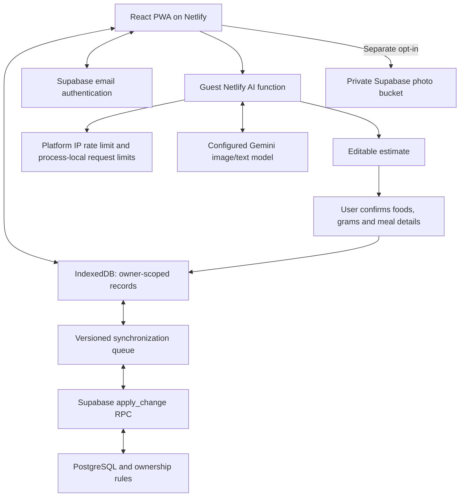

# KGM-FIT architecture

The UI reads local records. Food-energy totals, macro targets, text parsing and meal-plan calculations run in the browser. Normal food logging never needs an AI request.

`src/lib/db.ts` performs atomic local record/outbox writes and guest imports. Each change has a client-generated record UUID, operation UUID and expected previous version. `src/lib/cloud.ts` verifies the account, uses its pinned token, pulls owned records including tombstones, imports eligible guest records once, drains queued changes, and confirms the backend state. A guest diary is linked to its first verified account; imports skip records already present in that account.

`src/lib/useCloudSync.ts` owns the synchronization lifecycle and exposes one status and retry action to the app and account panel. It starts after account connection, debounces local changes, retries failures with backoff, and refreshes on reconnection, focus, visibility and every minute. Automatic and manual requests share an in-flight promise; Web Locks serialize supported browser tabs. Successful status requires completed backend reads/writes, an empty outbox and no unresolved conflicts. Account-session restoration completes before diary editing is enabled.

`supabase/migrations/001_lankafit.sql` creates typed entity tables with owner-scoped JSON payloads, a read-only shared food catalog, relational meal items and recipe ingredients, sync-operation receipts, quota accounting and private-storage policies. The payloads preserve historical nutrition snapshots and support the same representation offline. Parent/owner composite foreign keys prevent attaching children to another user's records.

Writes use the authenticated `apply_change` function. Its explicit owner check, record lock and expected-version comparison protect new records as well as updates. Direct client writes are revoked to prevent bypassing synchronization. A repeated operation ID is acknowledged without another write.

The optional AI function accepts guest requests with explicit consent, validates the image and asks Gemini for structured food suggestions and estimated nutrition. It uses Netlify's IP/domain rate limit plus process-local limits keyed by a hashed platform/socket IP. Daily counts are not durable across restarts or shared across instances. The old database quota schema is retained for compatibility but is no longer used by photo AI. The provider receives the photo and optional meal description; account identity, body measurements, health conditions and the full diary are excluded.

The review uses an unambiguous catalog match where available and creates an editable nutrition snapshot for every other food. Confirmation stores the reviewed meal and original estimate locally. A busy provider is retried once within a 45-second overall timeout; provider errors never create diary entries.

Guest mode uses its own local owner. Account switches close data-bearing dialogs and filter cached records before reading the next owner. Local-only drafts never enter the cloud queue.

The production service worker caches the build's app shell and static assets. It does not cache API calls, authentication responses, remote data or photo uploads. IndexedDB provides the diary's offline storage independently.

Cloud authentication/storage and real AI responses require external credentials. Those integrations remain separate from the fully local guest workflow and have explicit unavailable/error states.
