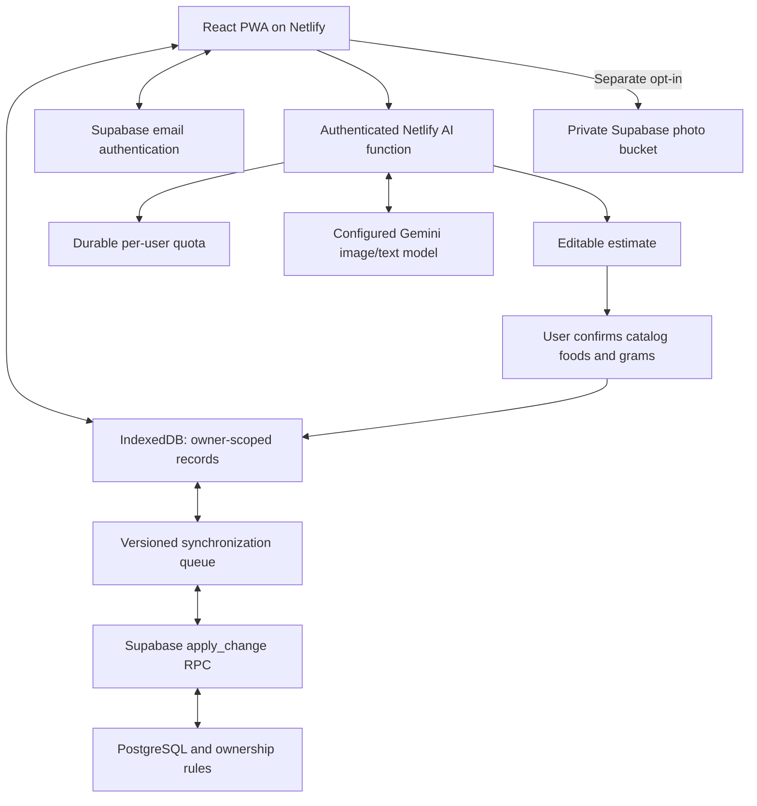

# KGM-FIT architecture

The UI reads local records. Food-energy totals, macro targets, text parsing and meal-plan calculations run in the browser. Normal food logging never needs an AI request.

`src/lib/db.ts` performs atomic local record/outbox writes. Each change has a client-generated record UUID, operation UUID and expected previous version. `src/lib/cloud.ts` verifies the account before pushing changes and then pulls owned records, including tombstones.

`supabase/migrations/001_lankafit.sql` creates typed entity tables with owner-scoped JSON payloads, a read-only shared food catalog, relational meal items and recipe ingredients, sync-operation receipts, quota accounting and private-storage policies. The payloads preserve historical nutrition snapshots and support the same representation offline. Parent/owner composite foreign keys prevent attaching children to another user's records.

Writes use the authenticated `apply_change` function. Its explicit owner check, record lock and expected-version comparison protect new records as well as updates. Direct client writes are revoked to prevent bypassing synchronization. A repeated operation ID is acknowledged without another write.

The optional AI function verifies the Supabase login token, enforces a database-backed quota, validates the image and asks Gemini for structured food suggestions. It returns data to the review screen. The provider receives no account identity, body measurements, health conditions or full diary.

Guest mode uses its own local owner. Account switches close data-bearing dialogs and filter cached records before reading the next owner. Local-only drafts never enter the cloud queue.

The production service worker caches the build's app shell and static assets. It does not cache API calls, authentication responses, remote data or photo uploads. IndexedDB provides the diary's offline storage independently.

Cloud authentication/storage and real AI responses require external credentials. Those integrations remain separate from the fully local guest workflow and have explicit unavailable/error states.
