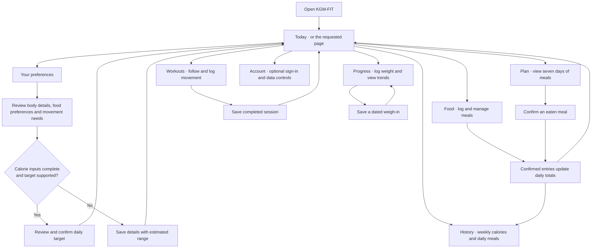
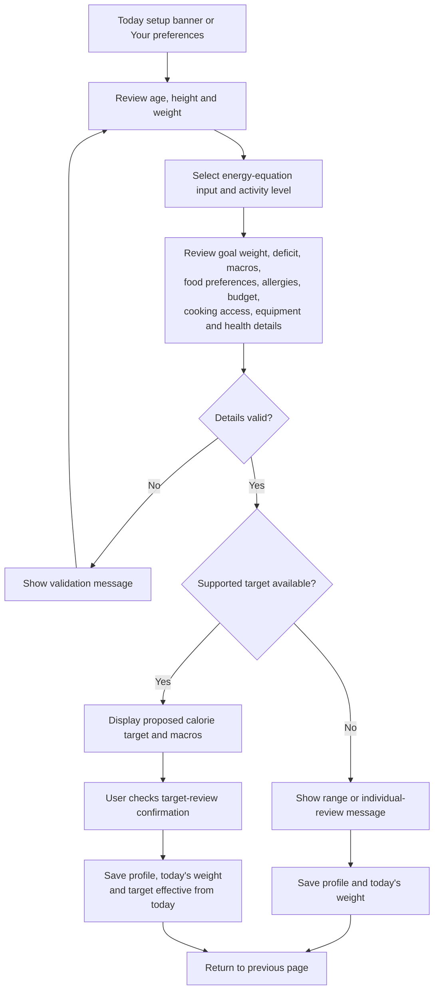
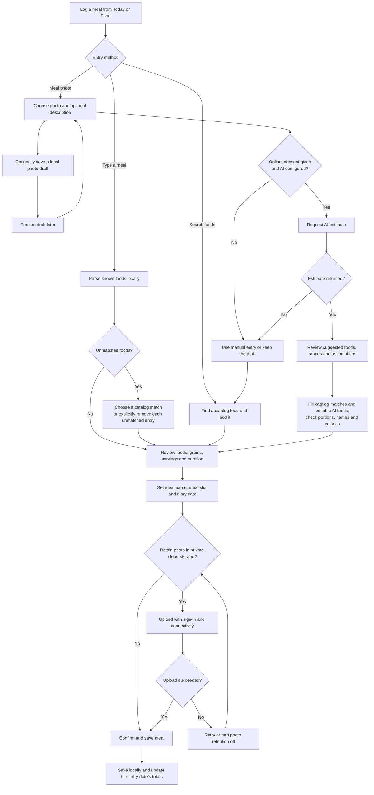
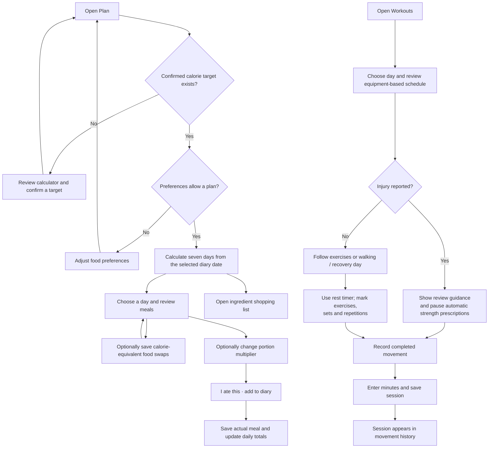
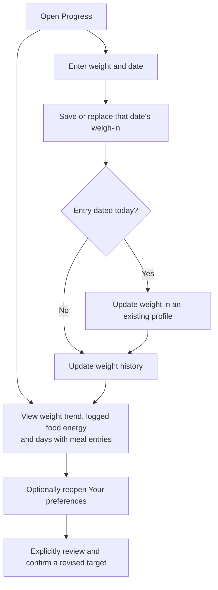
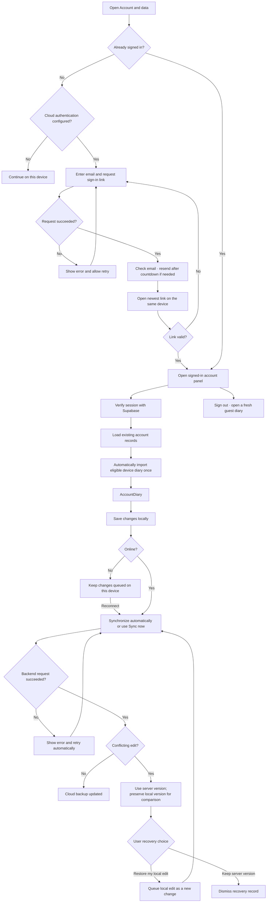

# KGM-FIT user flow

This flow describes the implemented application. It starts on Today by default; an existing deep link opens its corresponding page. Sign-in and target setup are optional, and manual food logging works before a calorie target is confirmed.

## Main journey

All six main pages remain available through the navigation. The shared diary-date selector controls the day being viewed; the meal editor and weigh-in form also allow choosing their own entry date. History groups saved meals into Monday–Sunday weeks, shows daily calories and opens a selected day's meals for review and editing.

## Starting point and target review

Initial body details are prefilled from the project brief. The equation input and activity level start unselected. Saving a new target preserves earlier target records. Saving a weigh-in later does not automatically recalculate the confirmed calorie target.

## Meal entry and review

Text parsing and catalog calculations run locally. Photo AI works for guests without sign-in. It fills the review with catalog matches or editable AI nutrition snapshots, shows an approximate calorie range and preserves the original estimate. The user checks foods, grams, meal name, slot and date before confirming. A confirmed meal updates the diary totals; uploading a photo or requesting an estimate alone does not log anything. Saving an entry from an opened photo draft removes that draft.

Existing meals open from the Today diary into the same editor. The user can update the meal, copy the reviewed contents to another selected date, or delete it. Deleted meals can be restored from **Food → Recently deleted meals**. The Food page also supports favorites, custom foods, and recipes calculated from ingredient quantities and finished batch weight.

## Meal plan and movement

Browsing a plan, changing a swap, or opening the shopping list does not count food as eaten. The **I ate this** action explicitly saves a meal. The shopping list uses the current seven-day plan and saved swaps; temporary portion multipliers affect the meal card and logged meal.

## Progress

## Optional account, backup and recovery

Guest and signed-in diaries use separate local owners. A verified account automatically receives eligible entries from its device's guest diary, which is then linked to that account. Signing out opens a fresh guest diary, hides account records and preserves unsynced account work for the same account's next sign-in. Local photo drafts are excluded from guest import and cloud synchronization. Signed-in changes synchronize automatically; the app also refreshes from Supabase every minute and when connectivity or foreground access returns. The account panel shows pending work, backend errors and the last successful sync.

The account panel also provides JSON export and a meal-history CSV, removal of retained cloud photos, and permanent guest-diary or account deletion after typing **DELETE**. JSON exports can include local photo drafts.

## Implementation references

- `src/App.tsx`: navigation, selected diary date, dialogs, account switching and automatic synchronization.
- `src/components/ProfileEditor.tsx`: profile fields, calculation review and target confirmation.
- `src/components/FoodComposer.tsx`: manual/text/photo entry, service status, draft handling and meal confirmation.
- `src/lib/ai.ts`: guest AI request, unique photo-food matching and editable estimated nutrition snapshots.
- `src/pages/Today.tsx` and `src/pages/Food.tsx`: diary entry points, catalog tools and deleted-meal recovery.
- `src/pages/History.tsx`: weekly calorie totals, daily meals and historical diary editing.
- `src/pages/Plan.tsx`: calculated plans, swaps, shopping list and eaten-meal confirmation.
- `src/pages/Workouts.tsx`: exercise completion, timers and session logging.
- `src/pages/Progress.tsx`: weigh-ins, profile-weight updates and trend views.
- `src/components/AccountPanel.tsx`: email sign-in, automatic synchronization status, retry, conflicts, exports and deletion.
